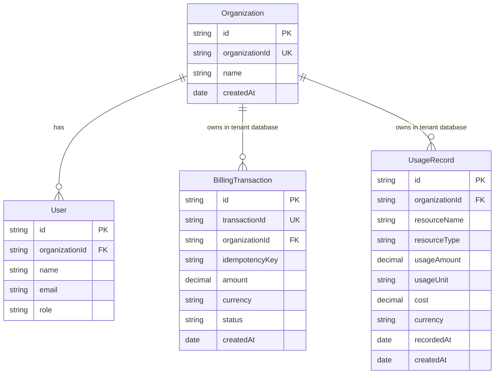

# Data Architecture & Persistence Layer

LedgerGuard persists shared organization and user metadata in MongoDB and stores billing and usage records in a MongoDB tenant database per organization, using Mongoose models. Redis supports service coordination and caching primitives.

## Database Configuration

| Service/Module | DB Type | Profile | Driver | Connection | Migration Tool |
|---|---|---|---|---|---|
| Backend shared metadata | MongoDB | Application default | Mongoose | `MONGODB_URI` | None detected; collections and indexes are model-managed |
| Backend tenant data | MongoDB | Per organization | Mongoose | `MONGODB_URI` with tenant-specific `dbName` | None detected; collections and indexes are model-managed |
| Backend coordination | Redis | Application default | Redis client | `REDIS_URL` | Not applicable |

MongoDB transactions used by billing require a replica set or supported sharded cluster. No separate database profiles, migration framework, or seed data were found.

## Data Ownership per Service

| Service | Tables / Collections Owned | ORM Framework | Caching | Notes |
|---|---|---|---|---|
| Backend authentication and organization metadata | `Organization`, `User` in the shared database | Mongoose | Redis connection is available; no entity cache identified | Organization IDs map authenticated users to a tenant database |
| Backend billing and analytics | `BillingTransaction`, `UsageRecord` in each tenant database | Mongoose | Redis used for billing locks; no analytics cache identified | `ResourceUsage` is not a second collection; usage is aggregated from `UsageRecord` |

## Entity Model

The shared database contains organization and user metadata. Tenant databases contain billing transactions and usage events; organization IDs remain on tenant records so query scopes and analytics grouping are explicit.

<!-- mermaid-checked: every attribute is `<type> <name> [<key>] ["<description>"]` with at most one of PK/FK/UK, no \n in descriptions, no {} in descriptions, every relationship label is double-quoted -->

`Organization` and `User` are shared-database Mongoose models. `BillingTransaction` and `UsageRecord` are instantiated from the tenant connection. The relationship lines show logical ownership; tenant separation also provides a database boundary. Billing has unique transaction and organization/idempotency indexes. Usage has organization/recorded-date and organization/resource-type/recorded-date indexes.

## Key Repository Methods

| Service | Repository / Model | Notable Methods | Purpose |
|---|---|---|---|
| Billing | `getBillingTransactionModel(connection)` in `backend/src/models/BillingTransaction.ts` | `find`, `findOne`, `create` | Tenant-scoped transaction listing, retrieval, and creation |
| Analytics | `getUsageRecordModel(connection)` in `backend/src/models/UsageRecord.ts` | `create`, `find`, `countDocuments`, `aggregate` | Tenant-scoped usage writes, paginated reads, and grouped reporting |
| Authentication | Shared Mongoose `Organization` and `User` models | `create`, `findOne`, `deleteOne` | Organization and account lookup and registration persistence |

## Caching Strategy

Redis is configured through `REDIS_URL`. The billing lock service uses Redis for time-limited idempotency coordination. No TTL-based analytics cache, query-result cache, or Mongoose second-level cache was identified.

## Data Ownership Boundaries

Organization and user metadata are in the shared MongoDB database. Billing and usage data are isolated into one tenant database per organization. Authenticated requests attach a tenant connection derived from the verified organization ID; analytics service methods also require an organization ID and include it in every listing and aggregation match. The tenant model factory prevents model queries from using the shared connection. Organization-level reporting is enabled by aggregating usage records inside the organization tenant. There is no cross-tenant analytics store or cross-service API access pattern identified. Redis is a shared coordination service.

### Data Classification & Sensitivity

| Entity | Sensitive Fields | Classification (PII/PHI/PCI/None) | Controls in Place |
|---|---|---|---|
| Organization | `name` | PII | Shared database; field-level encryption or masking was not identified |
| User | `name`, `email` | PII | Password is excluded from query selection by default; field-level encryption or masking was not identified |
| BillingTransaction | `amount`, `currency`, `description` | Financial data; no payment card fields detected | Tenant database separation; field-level encryption or masking was not identified |
| UsageRecord | `organizationId`, `resourceName`, `usageAmount`, `cost` | Organization usage and financial telemetry | Tenant database separation; field-level encryption or masking was not identified |
